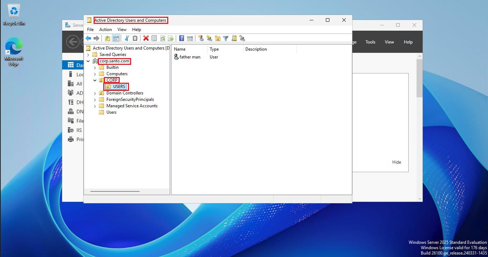
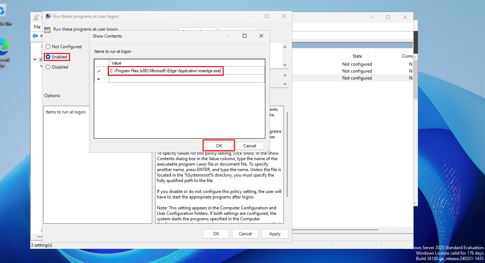
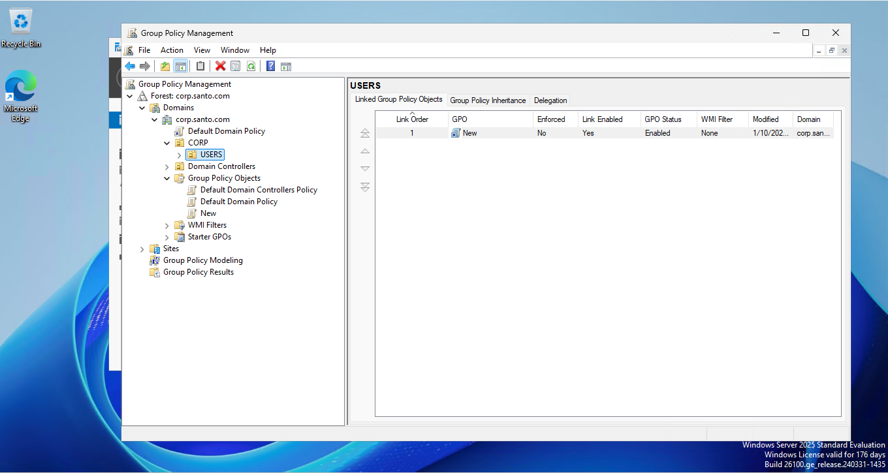
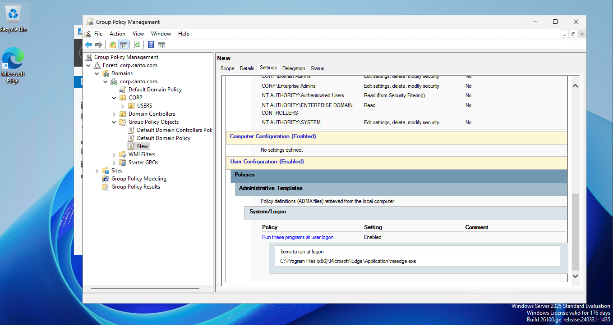
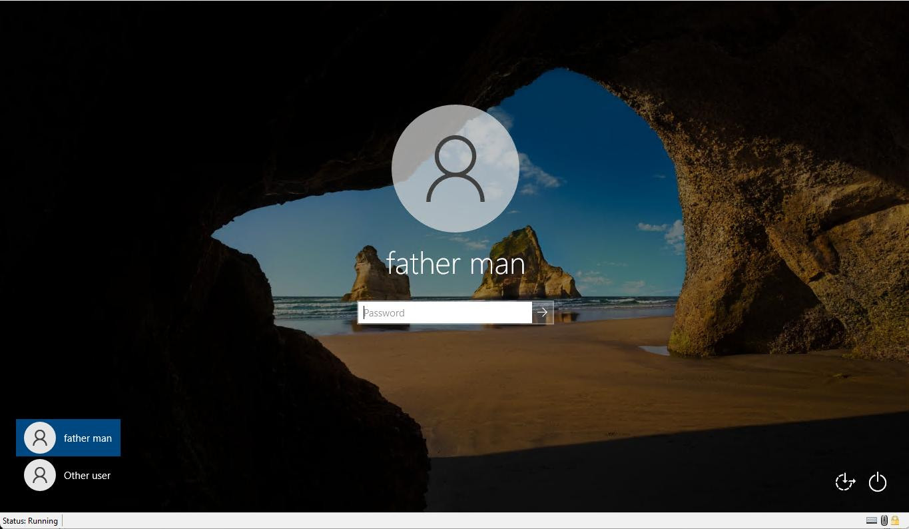
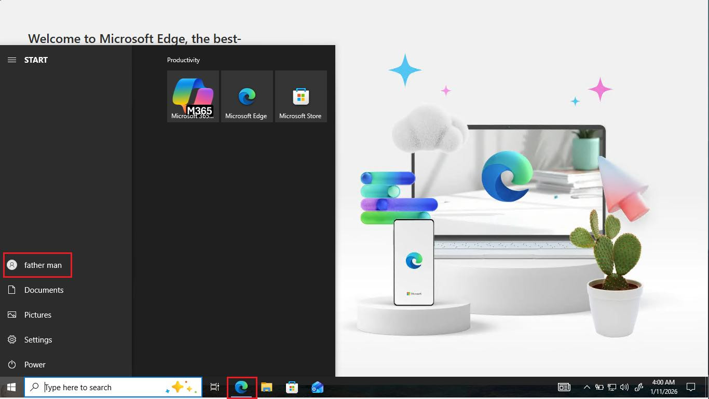
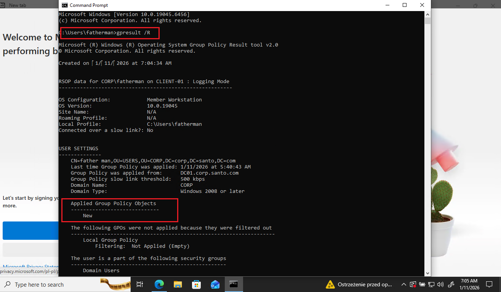

# Active Directory GPO — Automated Application Launch

**Project:** Microsoft Edge logon automation  
**Environment:** Windows Server 2025, Windows 10, `corp.santo.com`  
**Date:** January 2026

## Investigation objective

Configure a domain-based user Group Policy Object to open Microsoft Edge at user sign-in and verify that the policy is applied on the test client.

## Lab and tools

- **Server:** Windows Server 2025 domain controller in `corp.santo.com`.
- **Client:** Windows 10 (`CLIENT-01`).
- **Target:** `CORP / USERS` organizational unit.
- **Tools:** Active Directory Users and Computers, Group Policy Management Console and Editor, `gpresult /r`.
- **Hypervisor:** Hyper-V as described in the project setup.

## 1. Target OU identified

Active Directory Users and Computers showed the `USERS` OU beneath `CORP`, containing the domain test account.



## 2. GPO created

Created a domain GPO named **`New`** (the name visible in the lab screenshots).


## 3. User logon policy configured

Enabled `User Configuration → Policies → Administrative Templates → System → Logon → Run these programs at user logon` and entered:

```text
C:\Program Files (x86)\Microsoft\Edge\Application\msedge.exe
```



## 4. OU link and settings confirmed

Linked **`New`** to `CORP / USERS`. The linked-policy view showed the link enabled, and the GPO Settings tab displayed the configured rule.





## 5. Client validation

The test account was signed in on Windows 10. Microsoft Edge was documented open in the user session. `gpresult /r` showed `CORP\fatherman` on `CLIENT-01` and listed **`New`** under *Applied Group Policy Objects*.







## Findings

| Evidence | Finding |
|---|---|
| ADUC | Target user and `CORP / USERS` OU identified |
| Group Policy editor | Edge path entered in enabled user logon setting |
| GPMC link and Settings views | `New` linked to the USERS OU; setting enabled |
| `gpresult /r` | GPO `New` applied to the test user's session on `CLIENT-01` |
| Windows 10 screenshot | Edge displayed open after logon |

## Outcome and limitations

The configuration and client-side evidence support successful application of the lab GPO on the documented test client. This was a user logon application-launch setting, **not** an application installer or a production rollout. The screenshots do not establish deployment to additional clients, execution of `gpupdate /force`, or measurable time savings.

## Practical considerations

- Use a descriptive GPO name and record the scope and purpose for maintainability.
- Confirm the executable path on the client and verify user-targeted GPO scope.
- When troubleshooting a different machine, inspect DNS/domain connectivity and review `gpresult /r` before drawing conclusions about policy processing.
- These are operational considerations, not additional tests claimed to have been completed in this lab.
