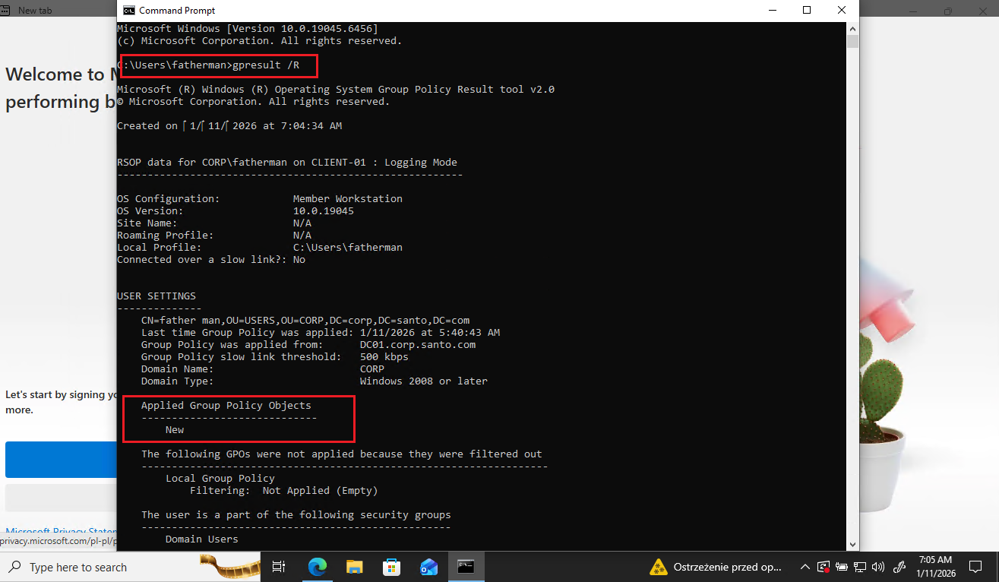
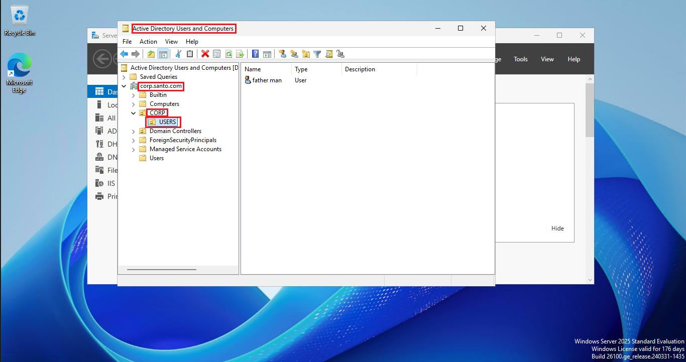
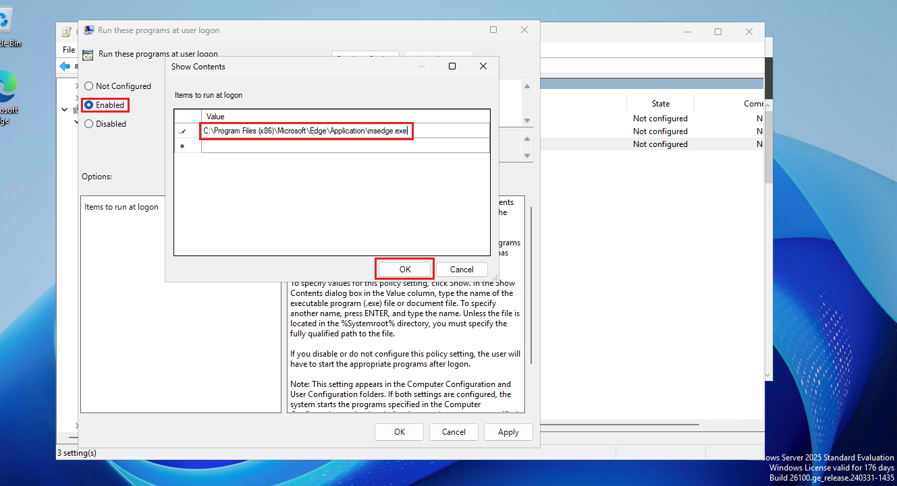
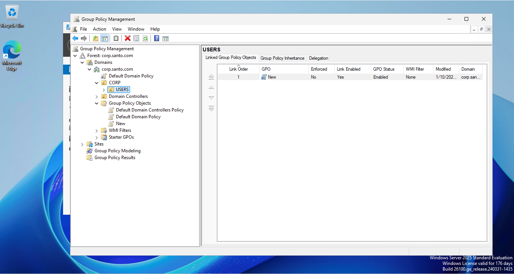
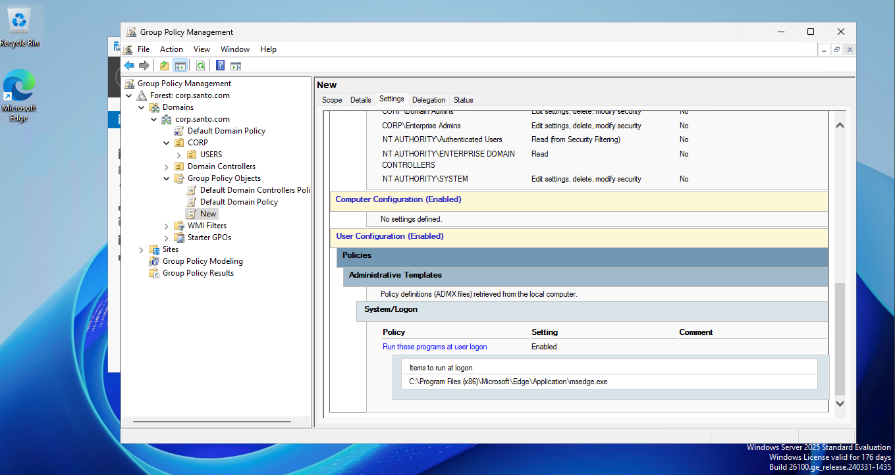
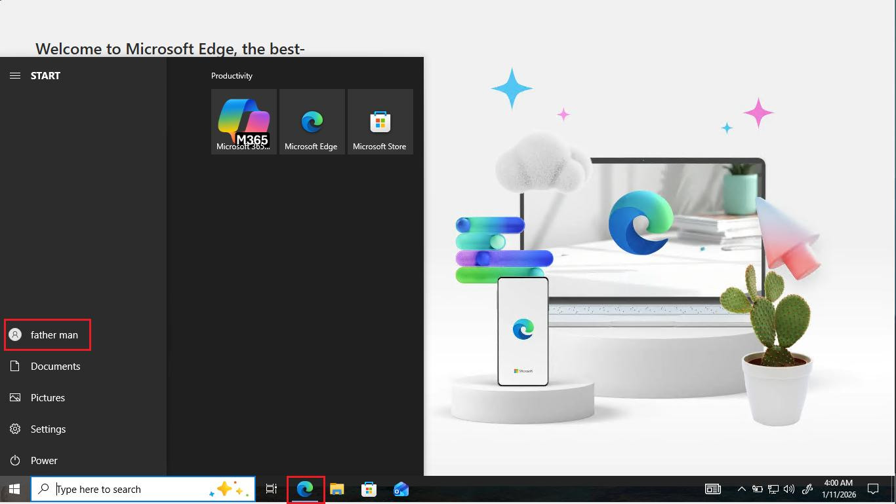

# Active Directory GPO — Automated Microsoft Edge Launch

**Windows Server 2025 | Active Directory | Group Policy | Windows 10 | January 2026**

I configured and tested a domain-based **Group Policy Object (GPO)** to launch Microsoft Edge automatically when a user signs in to a Windows 10 domain client. I used Active Directory Users and Computers and Group Policy Management to target the `USERS` organizational unit, configured the logon executable, and checked the applied policy on the client with `gpresult /r`.

## Results at a glance

- **Policy configured:** Enabled **Run these programs at user logon** and specified the Microsoft Edge executable.
- **Scope applied:** Linked the lab GPO **`New`** to `corp.santo.com / CORP / USERS`.
- **Client validation:** On `CLIENT-01`, `gpresult /r` listed **`New`** under *Applied Group Policy Objects* for the test user. Microsoft Edge was also documented open after logon.



## Lab environment

| Component | Configuration |
|---|---|
| Domain controller | Windows Server 2025 |
| Active Directory domain | `corp.santo.com` |
| Target OU | `CORP / USERS` |
| Client | Windows 10, `CLIENT-01` |
| Test account | `CORP\fatherman` |
| Hypervisor | Hyper-V (as documented in the lab setup) |
| Administration tools | Active Directory Users and Computers, Group Policy Management |
| Validation tool | `gpresult /r` |

## What I configured and verified

### 1. Identified the target users in Active Directory

I located the `USERS` OU under `CORP` in Active Directory Users and Computers. This provided the scope for a user-targeted logon policy.



### 2. Created and configured the logon GPO

In Group Policy Management, I created the GPO shown in the lab as **`New`** and enabled:

`User Configuration → Policies → Administrative Templates → System → Logon → Run these programs at user logon`

The configured program path was:

```text
C:\Program Files (x86)\Microsoft\Edge\Application\msedge.exe
```



### 3. Linked the policy to the USERS OU

I linked **`New`** to `CORP / USERS`. Group Policy Management showed the link enabled, and its Settings tab confirmed the logon policy and executable path.





### 4. Validated the policy on the Windows 10 client

I signed in with the domain test account and documented Microsoft Edge open in the user session. I then ran:

```cmd
gpresult /r
```

The output identified `CLIENT-01`, the `CORP\fatherman` user context, and **`New`** as an applied user GPO.




## Findings and outcome

| Check | Evidence | Outcome |
|---|---|---|
| OU targeting | Active Directory Users and Computers | `USERS` OU identified beneath `CORP` |
| Logon setting | Group Policy editor and Settings tab | Edge executable configured in an enabled user logon policy |
| Policy scope | GPMC linked-policy view | GPO `New` linked and enabled for `USERS` |
| Client policy application | `gpresult /r` on `CLIENT-01` | `New` listed as an applied user GPO |
| User-session result | Windows 10 desktop screenshot | Microsoft Edge shown open after domain logon |

**Outcome:** The lab demonstrates configuring, targeting, and validating a centralized user logon policy on **one documented Windows 10 client**. This is application *launch*, not installation or software deployment.

## Validation boundaries

- The screenshots document one test client; they do not establish deployment across multiple workstations.
- The GPO is named **`New`** in the captured configuration. A more descriptive name would be preferable for a production environment.
- The report documents `gpresult /r`; it does not provide a captured execution of `gpupdate /force` or quantitative time savings.
- The Edge path must exist on the client for this setting to work as intended.

## Technical report

[Active Directory GPO — Automated Application Launch (PDF)](01-active-directory-gpo-application-launch.pdf) · [Markdown report](01-active-directory-gpo-application-launch.md)
